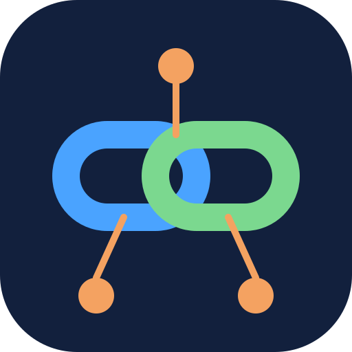

<div align="center">



# linkedin-mcp

**Let your AI agent read your LinkedIn profile basics and publish posts, through LinkedIn's official API.**

[](https://github.com/aigamer-dev/linkedin-mcp/actions/workflows/ci.yml)
[](LICENSE)
[](https://modelcontextprotocol.io)
[](https://nodejs.org)

[Website](https://aigamer-dev.github.io/linkedin-mcp/) · [Changelog](CHANGELOG.md) · [Contributing](CONTRIBUTING.md) · [Report a bug](https://github.com/aigamer-dev/linkedin-mcp/issues)

</div>

> Not affiliated with or endorsed by LinkedIn. "LinkedIn" is a trademark of LinkedIn Corporation.

## What it is

`linkedin-mcp` is a local [Model Context Protocol](https://modelcontextprotocol.io) server. It runs on your machine, talks to your AI agent over stdio, and calls LinkedIn's official OAuth 2.0 API with **your own** developer app. Your keys and token never leave your computer.

| Tool | Description | Inputs |
|------|-------------|--------|
| `get_profile` | Basic profile of the signed-in member: name, email, picture, locale | none |
| `create_post` | Publish a text post to your feed | `text` (1-3000 chars), `visibility` (`PUBLIC` or `CONNECTIONS`, default `PUBLIC`) |

LinkedIn does not offer profile editing, messaging, search or analytics to individual developers, so those are out of scope. See the [limits table](https://aigamer-dev.github.io/linkedin-mcp/#limits).

## Quick start

```bash
curl -fsSL https://raw.githubusercontent.com/aigamer-dev/linkedin-mcp/main/install.sh | bash
```

The script clones the repo to `~/.local/share/linkedin-mcp`, builds it, and registers it with every supported agent it finds. Then [connect your LinkedIn account](#connect-your-linkedin-account) (one time) and restart your agent.

Prefer to read the script first, or choose agents yourself:

```bash
git clone https://github.com/aigamer-dev/linkedin-mcp.git && cd linkedin-mcp
./install.sh --list                      # which agents were detected
./install.sh --agents claude,codex       # only these
./install.sh --dry-run                   # show what would change
./install.sh --uninstall                 # remove from detected agents
```

Requires Node.js 20+, npm and git (macOS or Linux). Each config file is backed up as `*.bak.<timestamp>` before it is edited.

## Install per agent

The installer runs the commands below for you. They are listed so you can run them by hand. Replace `/path/to/linkedin-mcp` with your install directory (default `~/.local/share/linkedin-mcp`).

| Agent | Command |
|-------|---------|
| **Claude Code** | `claude mcp add linkedin --scope user -- node /path/to/linkedin-mcp/dist/index.js` |
| **Codex CLI** | `codex mcp add linkedin -- node /path/to/linkedin-mcp/dist/index.js` |
| **OpenClaw** | `openclaw mcp add linkedin --command node --arg /path/to/linkedin-mcp/dist/index.js` |
| **Gemini CLI** | `gemini mcp add --scope user linkedin node /path/to/linkedin-mcp/dist/index.js` |

For editors and apps that use a JSON config, add this entry under `mcpServers` (`servers` for VS Code):

```json
{
  "mcpServers": {
    "linkedin": {
      "command": "node",
      "args": ["/path/to/linkedin-mcp/dist/index.js"]
    }
  }
}
```

| App | Config file |
|-----|-------------|
| Cursor | `~/.cursor/mcp.json` |
| Windsurf | `~/.codeium/windsurf/mcp_config.json` |
| Claude Desktop | `~/.config/Claude/claude_desktop_config.json` (Linux), `~/Library/Application Support/Claude/claude_desktop_config.json` (macOS) |
| VS Code | user `mcp.json` (uses a top-level `servers` key and `"type": "stdio"`) |
| OpenCode | `~/.config/opencode/opencode.json` (uses `"mcp"` with `"type": "local"` and a `command` array) |
| Gemini CLI (no CLI on PATH) | `~/.gemini/settings.json` |

Codex without its CLI on PATH, add to `~/.codex/config.toml`:

```toml
[mcp_servers.linkedin]
command = "node"
args = ["/path/to/linkedin-mcp/dist/index.js"]
```

Any other MCP client works too: launch `node dist/index.js` and speak MCP over stdio.

## Connect your LinkedIn account

One time, about five minutes.

1. Create a LinkedIn Page you administer (a small personal-brand page is fine) and an app at <https://www.linkedin.com/developers/apps>. App names cannot contain "LinkedIn".
2. On the **Products** tab, add **Share on LinkedIn** and **Sign In with LinkedIn using OpenID Connect**.
3. On the **Auth** tab, add the redirect URL `http://localhost:3000/callback`.
4. Put the client ID and secret in `.env` inside the install directory (the installer creates it from `.env.example`):

   ```bash
   LINKEDIN_CLIENT_ID=your-client-id
   LINKEDIN_CLIENT_SECRET=your-client-secret
   LINKEDIN_REDIRECT_URI=http://localhost:3000/callback
   ```

5. Authorize once, open the printed URL and approve:

   ```bash
   cd ~/.local/share/linkedin-mcp && npm run auth
   ```

6. Restart your agent.

The token is stored at `~/.config/linkedin-mcp/token.json` (mode 600), outside the repo, and lasts about 60 days. Re-run `npm run auth` to refresh it.

## Usage examples

Once connected, just ask your agent:

- "Who am I signed in as on LinkedIn?"
- "Draft a post about this week's release from CHANGELOG.md. Show it to me first, then publish it to my connections only."

## Security

- Credentials live only in your local `.env` and token file. Nothing is sent anywhere except `api.linkedin.com` and `www.linkedin.com`.
- `create_post` publishes as you, publicly by default. Set your agent to ask for approval on tool calls so every post is confirmed.
- Never commit `.env`; it is git-ignored. Report vulnerabilities privately through the repository's Security tab.

## Troubleshooting

| Symptom | Fix |
|---------|-----|
| `Not authenticated` | Run `npm run auth` in the install directory |
| `LinkedIn token expired` | Re-run `npm run auth` (tokens last about 60 days) |
| `redirect_uri` mismatch | The redirect URL in your LinkedIn app must be exactly `http://localhost:3000/callback` |
| `unauthorized_scope_error` | Add both products (Share on LinkedIn, Sign In with OpenID Connect) to your app |
| Port 3000 busy during `npm run auth` | Free the port, or change the URL in both `.env` and the LinkedIn app |
| Server not listed in the agent | Restart the agent; run `./install.sh --list` and check the config file path |
| App flagged for its name | Rename the app in the LinkedIn developer portal so it doesn't imitate LinkedIn branding |

## Contributing

Pull requests are welcome. Direct pushes to `main` are limited to the maintainer; everything else goes through a PR that needs 2 approvals and passing CI. See [CONTRIBUTING.md](CONTRIBUTING.md) for setup, tests, the release process and how to add support for another agent. Notable changes are tracked in [CHANGELOG.md](CHANGELOG.md).

## License

[MIT](LICENSE)
